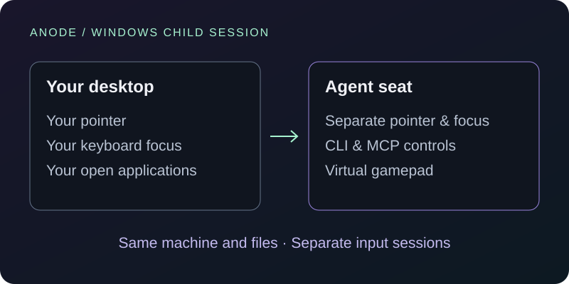
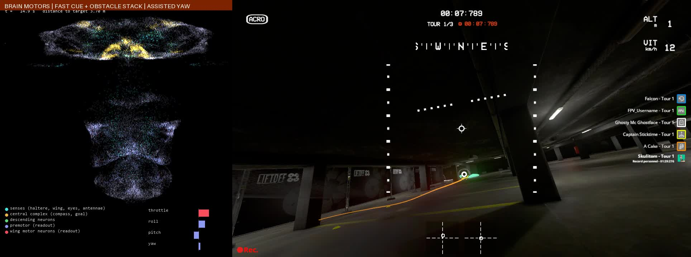

<picture>
  <source media="(max-width: 600px)" srcset="assets/v2/hello-mobile.svg">
  
</picture>

<a href="https://skulitom.github.io/"><picture><source media="(prefers-reduced-motion: reduce)" srcset="assets/links/v3/static/portfolio.svg"></picture></a>

I'm a **backend and infrastructure engineer at SimCorp**, based in London. I design and operate distributed calculation infrastructure, from worker coordination and batch scheduling to the data layer and failure investigation.

Previously: **Eigen Technologies · JPMorgan · founder of an education startup.** MEng Computer Science, **UCL**, specialising in AI.

**[LitHarness](https://github.com/skulitom/LitHarness) is my main independent project**, a Python tool for writing LitRPG serials with a coding agent. My other projects span agent tools, learned control, graphics, and game engines. I use coding agents throughout development, set the architecture and constraints, and review and verify their work.

[All repositories](https://github.com/skulitom?tab=repositories) · [Connect on LinkedIn](https://www.linkedin.com/in/artem-skulimovskiy-7bb028118/)

## Selected projects

<table>
<tr>
<td width="50%" valign="top">
<a href="https://github.com/skulitom/LitHarness"><picture><source media="(max-width: 600px)" srcset="assets/v2/litharness-mobile.svg"></picture></a>
<h3><a href="https://github.com/skulitom/LitHarness">LitHarness</a> · Main project</h3>

Turns a brief into a story bible, then plans and drafts LitRPG chapters with Codex or Claude Code. Checks character stats in code, recalls earlier passages, and keeps plain-file records so interrupted runs can resume. Literary-quality evaluation remains an open research problem.

<strong>Python · Coding agents · Local retrieval</strong> <a href="https://skulitom.github.io/litharness.html">Current workflow &amp; archived sample →</a>

</td>
<td width="50%" valign="top">

<h3><a href="https://github.com/skulitom/Anode">Anode</a></h3>

Gives an AI agent its own Windows desktop while you keep using your PC. Includes separate input focus, automation controls, and a virtual gamepad. Runs as the same user with access to the same files.

<strong>C# · .NET · Windows APIs · MCP</strong>

</td>
</tr>
<tr>
<td width="50%" valign="top">

<h3><a href="https://github.com/skulitom/haltere">Haltere</a></h3>

A 30,000-neuron connectome-constrained network for drone control in Liftoff. Published September results include a 5:17.805 three-lap Straw Bale finish with fast-brain-08 and pilot assistance. The newer fast-brain-11 improves obstacle handling but has no completed race; unseen-course flight remains unproven.

<strong>PyTorch · Differentiable simulation · 30,000 neurons</strong> <a href="https://skulitom.github.io/#haltere">Watch the Liftoff flight →</a> · <a href="https://github.com/skulitom/haltere#current-status">Current results</a>

</td>
<td width="50%" valign="top">

<h3><a href="https://github.com/skulitom/primordia">Primordia</a></h3>

An interactive GPU artificial-life laboratory: five worlds, 42 presets, saved discoveries, live measurements, and headless image and video export. Symbiosis couples agents and chemistry; a novelty search helps discover new patterns.

<strong>Rust · wgpu · WGSL</strong> <a href="https://skulitom.github.io/#primordia">Watch the simulations →</a>

</td>
</tr>
</table>

## More projects

| Project | What it does |
| --- | --- |
| [PixelForge](https://github.com/skulitom/PixelForge) | Turn JSON recipes into pixel art, sprite sheets, and animations. Includes a local studio, CLI, and MCP server; no runtime dependencies. |
| [Looking Glass](https://skulitom.github.io/LookingGlass/) | An unofficial *American McGee’s Alice* re-remaster in Rust. Experimental Windows preview with all 39 campaign visits; requires compatible game data supplied separately. |
| [Cutbolt](https://github.com/skulitom/Cutbolt) | A local Rust video editing engine for agents, with saved edit sessions, exact timelines, undo, rendering, and MCP controls. |

## Interactive web apps

Explore maps, practise Chinese, and back up your song lists.

<a href="https://skulitom.github.io/MapLanguageVisualizer/"><picture><source media="(prefers-reduced-motion: reduce) and (max-width: 374px)" srcset="assets/links/v3/static/world-language-map-narrow.svg"><source media="(max-width: 374px)" srcset="assets/links/v3/world-language-map-narrow.svg"><source media="(prefers-reduced-motion: reduce)" srcset="assets/links/v3/static/world-language-map.svg"></picture></a>
<a href="https://skulitom.github.io/export-atlas/"><picture><source media="(prefers-reduced-motion: reduce) and (max-width: 374px)" srcset="assets/links/v3/static/export-atlas-narrow.svg"><source media="(max-width: 374px)" srcset="assets/links/v3/export-atlas-narrow.svg"><source media="(prefers-reduced-motion: reduce)" srcset="assets/links/v3/static/export-atlas.svg"></picture></a>
<a href="https://skulitom.github.io/london-time-map/"><picture><source media="(prefers-reduced-motion: reduce) and (max-width: 374px)" srcset="assets/links/v3/static/london-in-minutes-narrow.svg"><source media="(max-width: 374px)" srcset="assets/links/v3/london-in-minutes-narrow.svg"><source media="(prefers-reduced-motion: reduce)" srcset="assets/links/v3/static/london-in-minutes.svg"></picture></a>
<a href="https://skulitom.github.io/chinese-touch-typing/"><picture><source media="(prefers-reduced-motion: reduce) and (max-width: 374px)" srcset="assets/links/v3/static/chinese-touch-typing-narrow.svg"><source media="(max-width: 374px)" srcset="assets/links/v3/chinese-touch-typing-narrow.svg"><source media="(prefers-reduced-motion: reduce)" srcset="assets/links/v3/static/chinese-touch-typing.svg"></picture></a>
<a href="https://skulitom.github.io/chinese-radicals/"><picture><source media="(prefers-reduced-motion: reduce) and (max-width: 374px)" srcset="assets/links/v3/static/chinese-radicals-narrow.svg"><source media="(max-width: 374px)" srcset="assets/links/v3/chinese-radicals-narrow.svg"><source media="(prefers-reduced-motion: reduce)" srcset="assets/links/v3/static/chinese-radicals.svg"></picture></a>
<a href="https://skulitom.github.io/spotify-library-vault/"><picture><source media="(prefers-reduced-motion: reduce) and (max-width: 374px)" srcset="assets/links/v3/static/keepsake-narrow.svg"><source media="(max-width: 374px)" srcset="assets/links/v3/keepsake-narrow.svg"><source media="(prefers-reduced-motion: reduce)" srcset="assets/links/v3/static/keepsake.svg"></picture></a>

Earlier experiments

[Latent Space Explorer](https://github.com/skulitom/Latent-Space-Explorer) — an experiment in steering generative images through semantic directions.

## Android apps

I also publish educational quiz apps on Google Play, covering language and history.

<a href="https://play.google.com/store/apps/details?id=com.greekletters.quiz"><picture><source media="(max-width: 600px)" srcset="assets/v2/app-greek-mobile.svg"></picture></a>

<a href="https://play.google.com/store/apps/details?id=com.armourquiz.medieval"><picture><source media="(max-width: 600px)" srcset="assets/v2/app-armour-mobile.svg"></picture></a>

<a href="https://play.google.com/store/apps/details?id=com.romanemperor.quiz"><picture><source media="(max-width: 600px)" srcset="assets/v2/app-roman-mobile.svg"></picture></a>

[View my Google Play developer page →](https://play.google.com/store/apps/developer?id=Skulitom)

## Technical toolkit

<strong>AI &amp; agent tooling</strong>

  
  
  
  

<strong>Languages &amp; interfaces</strong>

  
  
  
  

<strong>Systems &amp; data</strong>

  
  
  
  

 

