<picture><source media="(max-width: 600px) and (prefers-reduced-motion: reduce)" srcset="assets/v4/hero-mobile-still.svg"><source media="(max-width: 600px)" srcset="assets/v4/hero-mobile.svg"><source media="(prefers-reduced-motion: reduce)" srcset="assets/v4/hero-still.svg">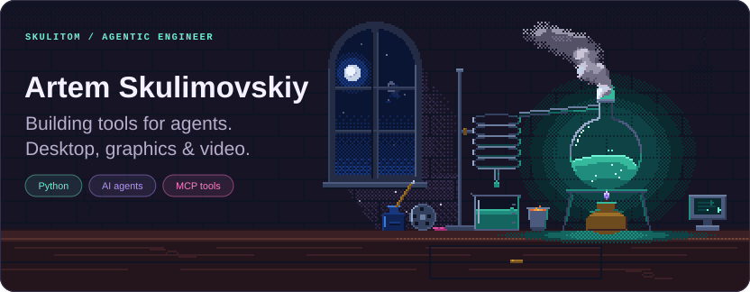</picture>

<p>
<a href="https://skulitom.github.io/"><picture><source media="(prefers-reduced-motion: reduce)" srcset="assets/links/v3/static/portfolio.svg"></picture></a>
</p>

I'm an **agentic engineer**, based in London. I build tools that let AI agents work with desktop apps, graphics, video, and creative workflows—with results people can inspect and revise.

My background is in **backend infrastructure and distributed systems at SimCorp**, previously **Eigen Technologies and JPMorgan**. MEng Computer Science, **UCL**, specialising in AI.

[All repositories](https://github.com/skulitom?tab=repositories) · [Connect on LinkedIn](https://www.linkedin.com/in/artem-skulimovskiy-7bb028118/)

## Tools for agents

<table>
<tr>
<td width="50%" valign="top">
<a href="https://github.com/skulitom/Anode"><picture><source media="(prefers-reduced-motion: reduce)" srcset="assets/v4/anode-still.svg">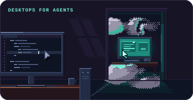</picture></a>
<h3><a href="https://github.com/skulitom/Anode">Anode</a></h3>
<p>Give an agent its own background Windows desktop to use and test apps while you keep working. Screenshots, accessibility controls, and separate mouse and keyboard focus. Runs as your user with access to your files.</p>
<p><strong>C# · Windows APIs · MCP</strong></p>
</td><td width="50%" valign="top">
<a href="https://github.com/skulitom/Inkbolt"><picture><source media="(prefers-reduced-motion: reduce)" srcset="assets/v4/inkbolt-still.svg">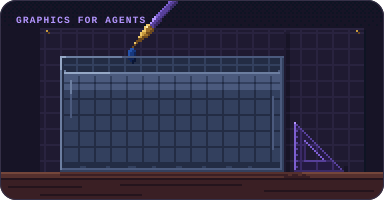</picture></a>
<h3><a href="https://github.com/skulitom/Inkbolt">Inkbolt</a></h3>
<p>Local vector and raster editing for diagrams, illustrations, and image assets. Agents preview and revise artwork, keep editable sources, and export the result.</p>
<p><strong>Rust · MCP · JSON CLI</strong></p>
</td>
</tr>
<tr>
<td width="50%" valign="top">
<a href="https://github.com/skulitom/Cutbolt"><picture><source media="(prefers-reduced-motion: reduce)" srcset="assets/v4/cutbolt-still.svg">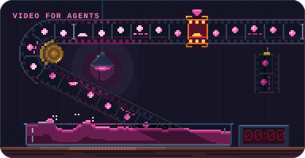</picture></a>
<h3><a href="https://github.com/skulitom/Cutbolt">Cutbolt</a></h3>
<p>A local video editing engine for agents. Arrange footage, add captions and graphics, mix sound, and export—with saved revisions and undo.</p>
<p><strong>Rust · FFmpeg · MCP</strong></p>
</td><td width="50%" valign="top">
<a href="https://github.com/skulitom/Pixelbolt"><picture><source media="(prefers-reduced-motion: reduce)" srcset="assets/v4/pixelbolt-still.svg">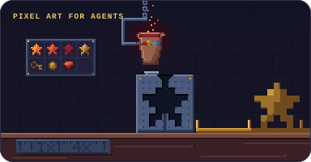</picture></a>
<h3><a href="https://github.com/skulitom/Pixelbolt">Pixelbolt</a></h3>
<p>Pixel art and animation from editable JSON recipes. Agents make, preview, and revise sprites and atlases; people can edit the same recipe in a local studio.</p>
<p><strong>JavaScript · MCP · Local studio</strong></p>
</td>
</tr>
</table>

<sub>The header, tool cards and footer art were made with <a href="https://github.com/skulitom/Pixelbolt">Pixelbolt</a>: the liquids, mist and steam are real fluid simulations, shaded and animated as pixel art.</sub>

<details>
<summary>How this art was made</summary>

AI agents made the header, tool cards and footer with Pixelbolt, the pixel-art tool for agents. Small Python generators write the JSON recipes and fluid sources; Pixelbolt runs the simulations and draws every pixel; a short wrapper packs the sprite sheets into self-contained animated SVGs. The sources are in [`art/`](art/), and one command rebuilds everything to the same bytes:

```bash
bash art/build.sh
```

</details>

**[Nestbolt](https://github.com/skulitom/Nestbolt)** — sheet nesting for laser, CNC, and fabric cutting, with browser, CLI, and MCP interfaces.

**[AgentUI](https://github.com/skulitom/AgentUI)** — forms, sliders, diffs, and live previews for decisions between people and coding agents.

## Agent workflows & experiments

| Project | What it explores |
| --- | --- |
| [LitHarness](https://github.com/skulitom/LitHarness) | Write LitRPG serials with Codex or Claude Code, with story state, deterministic checks, local retrieval, and resumable runs. [Workflow & archived sample](https://skulitom.github.io/litharness.html). |
| [Haltere](https://github.com/skulitom/haltere) | A fruit-fly connectome trained for drone control in Liftoff. Experimental controllers, assisted flight, and [published results](https://github.com/skulitom/haltere#current-status). |
| [Primordia](https://github.com/skulitom/primordia) | A GPU artificial-life laboratory with five worlds, 42 presets, saved discoveries, and headless exports. |
| [Looking Glass](https://skulitom.github.io/LookingGlass/) | An experimental Rust re-remaster of *American McGee’s Alice*; requires compatible game data. |

## Interactive web apps

Explore maps, practise Chinese, and back up your song lists.

<p>
<a href="https://skulitom.github.io/MapLanguageVisualizer/"><picture><source media="(prefers-reduced-motion: reduce) and (max-width: 374px)" srcset="assets/links/v3/static/world-language-map-narrow.svg"><source media="(max-width: 374px)" srcset="assets/links/v3/world-language-map-narrow.svg"><source media="(prefers-reduced-motion: reduce)" srcset="assets/links/v3/static/world-language-map.svg"></picture></a>
<a href="https://skulitom.github.io/export-atlas/"><picture><source media="(prefers-reduced-motion: reduce) and (max-width: 374px)" srcset="assets/links/v3/static/export-atlas-narrow.svg"><source media="(max-width: 374px)" srcset="assets/links/v3/export-atlas-narrow.svg"><source media="(prefers-reduced-motion: reduce)" srcset="assets/links/v3/static/export-atlas.svg"></picture></a>
<a href="https://skulitom.github.io/london-time-map/"><picture><source media="(prefers-reduced-motion: reduce) and (max-width: 374px)" srcset="assets/links/v3/static/london-in-minutes-narrow.svg"><source media="(max-width: 374px)" srcset="assets/links/v3/london-in-minutes-narrow.svg"><source media="(prefers-reduced-motion: reduce)" srcset="assets/links/v3/static/london-in-minutes.svg"></picture></a>
<a href="https://skulitom.github.io/chinese-touch-typing/"><picture><source media="(prefers-reduced-motion: reduce) and (max-width: 374px)" srcset="assets/links/v3/static/chinese-touch-typing-narrow.svg"><source media="(max-width: 374px)" srcset="assets/links/v3/chinese-touch-typing-narrow.svg"><source media="(prefers-reduced-motion: reduce)" srcset="assets/links/v3/static/chinese-touch-typing.svg"></picture></a>
<a href="https://skulitom.github.io/chinese-radicals/"><picture><source media="(prefers-reduced-motion: reduce) and (max-width: 374px)" srcset="assets/links/v3/static/chinese-radicals-narrow.svg"><source media="(max-width: 374px)" srcset="assets/links/v3/chinese-radicals-narrow.svg"><source media="(prefers-reduced-motion: reduce)" srcset="assets/links/v3/static/chinese-radicals.svg"></picture></a>
<a href="https://skulitom.github.io/spotify-library-vault/"><picture><source media="(prefers-reduced-motion: reduce) and (max-width: 374px)" srcset="assets/links/v3/static/keepsake-narrow.svg"><source media="(max-width: 374px)" srcset="assets/links/v3/keepsake-narrow.svg"><source media="(prefers-reduced-motion: reduce)" srcset="assets/links/v3/static/keepsake.svg"></picture></a>
</p>

<details>
<summary>Earlier experiments</summary>

[Latent Space Explorer](https://github.com/skulitom/Latent-Space-Explorer) — an experiment in steering generative images through semantic directions.

</details>

<details>
<summary>Android apps</summary>

### Android apps

I also publish educational quiz apps on Google Play, covering language and history.

<a href="https://play.google.com/store/apps/details?id=com.greekletters.quiz"><picture><source media="(max-width: 600px)" srcset="assets/v2/app-greek-mobile.svg"></picture></a>

<a href="https://play.google.com/store/apps/details?id=com.armourquiz.medieval"><picture><source media="(max-width: 600px)" srcset="assets/v2/app-armour-mobile.svg"></picture></a>

<a href="https://play.google.com/store/apps/details?id=com.romanemperor.quiz"><picture><source media="(max-width: 600px)" srcset="assets/v2/app-roman-mobile.svg"></picture></a>

[View my Google Play developer page →](https://play.google.com/store/apps/developer?id=Skulitom)

</details>

## Background & toolkit

I use Codex and Claude Code throughout development: I set the architecture and constraints, review changes, and verify results. My systems work spans worker coordination, batch scheduling, data layers, and failure investigation.

### Technical toolkit

<p align="center"><strong>AI &amp; agent tooling</strong></p>
<p align="center">
  
  
  
  
</p>

<p align="center"><strong>Languages &amp; interfaces</strong></p>
<p align="center">
  
  
  
  
</p>

<p align="center"><strong>Systems &amp; data</strong></p>
<p align="center">
  
  
  
  
</p>

<br>

<picture><source media="(prefers-reduced-motion: reduce)" srcset="assets/v4/footer-still.svg">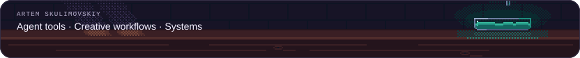</picture>
